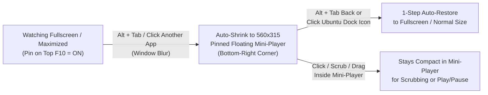

```bash
$ crunchyroll --ozone-platform=x11
```

<h1 align="center">🎬 Crunchyroll Ubuntu Desktop</h1>
<h3 align="center">Modernist Glassmorphic UI, Custom Lists, Auto-Skip HUD, Mouse/Trackpad & Smart Auto-PiP Edition for Linux</h3>

<p align="center">
  <a href="https://github.com/pulkitmundra/crunchyroll-ubuntu-desktop">
    
  </a>
</p>

<p align="center">
  
  
  
  
</p>

<p align="center">
  <a href="https://github.com/pulkitmundra/crunchyroll-ubuntu-desktop/stargazers"></a>&nbsp;
  <a href="https://github.com/pulkitmundra"></a>&nbsp;
  <a href="https://pulkit-mundra-portfolio.vercel.app"></a>
</p>

<p align="center">
  <a href="#comparison">Comparison</a> -
  <a href="#architecture">Architecture</a> -
  <a href="#features">Features</a> -
  <a href="#quick-start">Quick Start</a> -
  <a href="#shortcuts">Shortcuts</a> -
  <a href="#author">Author</a>
</p>

> [!NOTE]
> **Disclaimer**: This project is an unofficial, community-maintained desktop client and is **not** affiliated with, endorsed by, or associated with Crunchyroll or Sony Pictures Entertainment. A valid Crunchyroll account is required to stream content.

---

<a id="comparison"></a>
## ⚡ Upstream vs. This Edition

The upstream `crunchyroll-linux` / `crunchyroll-tizen` project was built strictly for TV remote / arrow-key navigation and lacked desktop ergonomics. This edition transforms it into a first-class Ubuntu desktop & multitasking app:

| Capability | Upstream (`crunchyroll-linux`) | This Edition (`crunchyroll-ubuntu-desktop`) |
| :--- | :---: | :---: |
| **Widevine DRM Streaming (1080p)** | `[x]` | `[x]` |
| **Keyboard / Controller Navigation** | `[x]` | `[x]` |
| **Unified Modernist Minimal Glassmorphic UI** | `[ ]` | `[x]` |
| **Crunchyroll Star Ratings (`4.9 (120K)`) & `Sub \| Dub` Badges** | `[ ]` | `[x]` |
| **Custom Lists ("Crunchylists") & Watchlist Manager Modal** | `[ ]` | `[x]` |
| **Skip Intro, Skip Recap & Skip Credits + `3.2s` Auto-Skip** | `[ ]` | `[x]` |
| **In-Player Season Episode List Drawer (`E`)** | `[ ]` | `[x]` |
| **Click-to-Play & Double-Click Fullscreen (`F` / `F11`)** | `[ ]` | `[x]` |
| **Hover-Preview Scrubber, `5s` Wheel Seek & Full-Pill Volume Drag** | `[ ]` | `[x]` |
| **Synchronized Cursor + HUD Auto-Hide (Video Player Only)** | `[ ]` | `[x]` |
| **Floating Mini-Player (`560x315`, `F9`) & Scaled PiP Controls** | `[ ]` | `[x]` |
| **Smart Auto-PiP on `Alt + Tab` (`F10`)** | `[ ]` | `[x]` |
| **Persistent Context-Aware `<- Back` Pill & `Backspace` / `Alt+Left`** | `[ ]` | `[x]` |
| **Two-Finger Trackpad & Mouse Wheel Scroll + Inline Lazy-Loader** | `[ ]` | `[x]` |
| **Hover-to-Open Left Sidebar Menu & Top Dock Menu Toggle** | `[ ]` | `[x]` |
| **Physical Keyboard Live Debounced Search (`Ctrl + F` / `/`)** | `[ ]` | `[x]` |
| **One-Command Live-Editable Installer (`install.sh`)** | `[ ]` | `[x]` |

---

<a id="architecture"></a>
## 🧠 Smart Auto-PiP & Window Architecture

When **Pin on Top (`F10`)** is enabled, the Electron main process (`index.js`) and preload bridge (`preload.js`) coordinate focus, pointer telemetry, and dynamic zoom scaling (`1920x1080` -> `560x315`) so you can seamlessly multitask while watching:



---

<a id="features"></a>
## ✨ Key Desktop Enhancements

<details open>
<summary><b>1. 🎥 Video Player, Auto-Skip Segments & Episode Drawer (<code>video.js</code>, <code>player.js</code>, <code>app.js</code>, <code>video.css</code>)</b></summary><br>

- **Skip Intro, Skip Recap & Skip Credits + Animated Auto-Skip**:
  - Integrates with Crunchyroll's skip-events service (`static.crunchyroll.com/skip-events`) to detect **Recap**, **Intro**, and **Credits** segments (`Click`, `Enter`, or `S` shortcut), stacking cleanly above the **Next Episode** countdown card during ending credits.
  - Configurable **Playback & Auto-Skip** toggles in **Settings** (`Auto-Skip Intro`, `Auto-Skip Credits`, `Auto-Skip Recap`, `Auto-Play Next Episode`, `Show Skip Buttons`). When Auto-Skip is enabled for a segment, the skip pill displays a smooth **`3.2s` animated progress fill** from left to right; clicking anywhere else in the player window (or pressing `Esc` / `Backspace` / `Space`) aborts the auto-skip countdown for that segment without interrupting playback.
- **In-Player Season Episode List Drawer (`E`)**:
  - Click the **Episodes** icon in the player OSD or press `E` to slide out a frosted glass drawer listing all episodes in the current season with thumbnails, watch progress bars, `Sub | Dub` badges, and 1-click episode switching without leaving the player.
- **Hover-Preview Timeline Scrubber & Full-Pill Volume Slider**:
  - Sleek `5px` progress track that expands to `12px` on hover with a glowing circular thumb, ghost hover-fill bar (`#seek-hover`), floating timestamp preview (`#seek-tooltip`), click-and-drag scrubbing, and `5s` mouse-wheel timeline seeking.
  - Click-and-drag volume scrubbing across the entire `#osd-volume` pill container, plus `Playback Speed` control (`0.25x` - `2x` via `[` / `]` or the `fa-gauge-high` OSD menu).
- **Synchronized Auto-Hide HUD & Cursor**:
  - Scoped strictly to `#video-screen` so the cursor never disappears on non-video screens, and automatically stays visible whenever the Audio/Subtitles drawer, Episodes drawer, Sidebar Menu, or Exit modal is open.

</details>

<details open>
<summary><b>2. 🪟 Top Command Bar, Mini-Player (<code>F9</code>), Smart Auto-PiP (<code>F10</code>) & Bounded Scaling</b></summary><br>

- **Top-Center Frosted Command Bar (`#top-center-dock`)**: Auto-hiding segmented glass command bar at the top center of the window with 1-click buttons for **Menu** (opens the navigation sidebar across all screens including the Video Player), **Mini Float (`F9`)**, and **Pin on Top (`F10`)**.
- **Floating Mini-Player Mode (`F9` or `Ctrl + M`)**: Instantly shrinks the window into a compact `560x315` floating player in the bottom-right corner of your screen (and restores back to normal/fullscreen when toggled again), with XWayland/GNOME Mutter state enforcement so dragging and resizing the PiP window never locks up.
- **Pin on Top & Smart Auto-PiP (`F10` or `Ctrl + T`)**:
  - When **Pin on Top** is enabled, switching focus away from Crunchyroll (`Alt + Tab` or clicking another app) automatically shrinks Crunchyroll into a pinned floating mini-player so you can keep watching while coding or browsing.
  - Returning to Crunchyroll via `Alt + Tab` or clicking the Ubuntu Dock icon automatically expands it back to full size in one step, whereas clicking or dragging directly inside the mini-player keeps it compact.
- **Bounded `--ui-scale` Responsive Controls (`updateZoom` & `checkCompactWindow`)**: Automatically scales the `1920x1080` layout proportionally across any window size while applying a continuous, strictly capped `--ui-scale` multiplier to floating controls and compact PiP buttons so controls are easy to click in `560x315` PiP mode without becoming oversized at half-screen aspect ratios.

</details>

<details open>
<summary><b>3. 🎨 Unified Modernist UI, Star Ratings, <code>Sub | Dub</code> Badges & Custom Lists ("Crunchylists")</b></summary><br>

- **Unified Modernist Minimal Design System**:
  - Every screen (`Home`, `Category View`, `Anime Details`, `Seasons & Episodes`, `Browse`, `My List`, `Watch History`, `Search`, `Settings`, `Profile Switcher`, `Login`, and `Video Player`) shares a cohesive frosted-obsidian aesthetic (`#08080c` base, `backdrop-filter: blur(14px-22px)` surfaces, hairline borders, `#f47521` accents, and a pixel-exact `124px` left alignment rail).
  - Compact `36vh` Home hero banner while browsing rows (giving poster carousels `64vh` of vertical space with zero bottom dead space) that expands to `52vh` when the hero banner is focused.
- **Crunchyroll Star Ratings & `Sub | Dub` Badges**:
  - Displays Crunchyroll Star Rating pills (`4.9 (120K)`), `Sub | Dub` / `Sub` / `Dub` audio badges, maturity ratings, season/episode counts, and genre chips across the Home hero banner, Anime Details, My List, and poster/episode cards.
- **Custom Lists ("Crunchylists") & Watchlist Manager**:
  - Click **Manage Lists** on the Anime Details screen to toggle Watchlist membership, add/remove the series across any of your Custom Lists ("Crunchylists"), create new Custom Lists, or delete Custom Lists.
  - Hover any card in **My List** (`Watchlist` or Custom Lists) to access a 1-click quick-remove trash button (`.mylist-quick-remove`).

</details>

<details open>
<summary><b>4. 🖱️ Context-Aware <code>&lt;- Back</code> Pill, Smooth Wheel/Trackpad Scroll & Keyboard Navigation</b></summary><br>

- **Persistent On-Screen `<- Back` Pill (`#screen-back-btn`) & Shortcuts**:
  - Context-aware `<- Back` pill in the top-left corner across all non-root screens (`Anime Details`, `Seasons & Episodes`, `Video Player`, `Category View`, `Search`, `Browse`, `My List`, `History`, `Settings`), paired with `Backspace`, `Alt + Left`, `Escape`, and Right-Click back navigation.
- **Hover-to-Open Left Sidebar (`#menu-screen`)**: Moving the cursor to the left edge or clicking **Menu** in the top dock slides out the glassmorphic navigation rail and collapses it when the cursor leaves.
- **Smooth Native & Virtualized Scrolling**:
  - Native vertical scrolling in **Settings** (`Subtitle Language`, `Audio Language`, `Application Language`) and in-player drawers (`Audio`, `Subtitles`, `Episodes`), with click-only submenu switching in Settings.
  - 2D wheel and two-finger trackpad scrolling across Home and My List horizontal carousels (with full last-card scroll bounds) and Browse Category rows (with scroll-position preservation and an inline `.row-lazy-loader` spinner card when fetching more anime tiles).
- **Redesigned Login, Live Search & About (`v2.0.0`)**:
  - Frosted glass Login screen with password visibility toggle (`Alt + V`), X11-safe Caps Lock warning pill, inline validation, and `Remember email`.
  - Live debounced physical keyboard search (`400ms`, `Ctrl + F` or `/`) with a clear (`X`) button, plus a revamped **Settings -> About** view with runtime badges and shortcut cheat sheets.

</details>

---

<a id="quick-start"></a>
## 🚀 Quick Start (Ubuntu / Debian / Linux x64)

Because Crunchyroll streams are encrypted with **Google Widevine DRM**, standard stock Electron binaries cannot play videos. This app runs inside the **Castlabs Electron for Content Security (ECS)** runtime (which includes Widevine CDM verification).

### One-Command Setup

```bash
git clone https://github.com/pulkitmundra/crunchyroll-ubuntu-desktop.git ~/Desktop/prsnl/crunchyroll-ubuntu-desktop
cd ~/Desktop/prsnl/crunchyroll-ubuntu-desktop
chmod +x install.sh
./install.sh
```

<details>
<summary><b>🔍 What <code>./install.sh</code> does under the hood (Click to expand)</b></summary><br>

1. Downloads the v1.1.6 AppImage containing the **Castlabs Electron + Widevine** runtime to `~/.local/opt/crunchyroll/Crunchyroll.AppImage` (if not already present).
2. Extracts the runtime into `~/.local/opt/crunchyroll/unpacked/`.
3. Removes the stock `resources/app.asar` bundle and symlinks `~/.local/opt/crunchyroll/unpacked/resources/app` -> this repository.
   - **Live Editing**: Any change you make to `.js`, `.css`, or `.html` files in this repository takes effect immediately the next time you launch or reload (`Ctrl + R` / `F5`) the app!
4. Symlinks `~/.local/bin/crunchyroll` -> `bin/crunchyroll` and installs the desktop launcher at `~/.local/share/applications/crunchyroll-linux.desktop`.

</details>

### Launching the App

- **GNOME Application Grid**: Search for **Crunchyroll**
- **Terminal**:
  ```bash
  crunchyroll
  ```

---

<a id="shortcuts"></a>
## 🎮 Keyboard & Mouse Shortcuts

| Action | Mouse / Trackpad | Keyboard |
| :--- | :--- | :--- |
| **Play / Pause** | Single-click video or Play button | `Space`, `K`, or `Enter` |
| **Toggle Fullscreen** | Double-click video | `F` or `F11` |
| **Toggle Mini Float Window** | Click **Mini Float** in top dock | `F9` or `Ctrl + M` |
| **Toggle Pin on Top / Auto-PiP** | Click **Pin on Top** in top dock | `F10` or `Ctrl + T` |
| **Seek `5s` / `10s`** | Click/drag timeline or scroll wheel on bar | `Left` / `Right` (`5s`), `J` / `L` (`10s`) |
| **Volume / Mute** | Click/drag `#osd-volume` pill or wheel | `Up` / `Down` Arrow, `M` (Mute) |
| **Playback Speed (`0.25x` - `2x`)** | Click **Speed** (`fa-gauge-high`) in OSD | `[` (Slower) / `]` (Faster) |
| **Skip Recap / Intro / Credits** | Click **Skip** pill (click elsewhere to abort auto-skip) | `S` or `Enter` |
| **In-Player Episodes Drawer** | Click **Episodes** in OSD | `E` |
| **Audio & Subtitles Drawer** | Click **Audio & Subtitles** in OSD | `C` |
| **Next Episode / Aspect Ratio** | Click **Next** / **Expand** in OSD | `N` (Next) / `Z` (Aspect Ratio) |
| **Open Sidebar Menu** | Hover left edge or click **Menu** in top dock | `Left` Arrow from screen edge |
| **Global Search** | Click **Search** in sidebar menu | `Ctrl + F` or `/` |
| **Back / Close Modal** | Click `<- Back` pill or Right-click anywhere | `Escape`, `Backspace`, or `Alt + Left` |
| **Reload App (Ignore Cache)** | - | `F5` or `Ctrl + R` |
| **Quit Application** | Confirm Exit Dialog | `Ctrl + Q` |

---

<details>
<summary><b>📂 Repository Structure (Click to expand)</b></summary><br>

```text
crunchyroll-ubuntu-desktop/
├── index.js                      # Electron main process (window, mini-player, auto-PiP, fullscreen IPC)
├── preload.js                    # Electron preload bridge (pointer/hover telemetry & window IPC)
├── index.html                    # Outer Electron shell
├── package.json                  # Package metadata (v2.0.0)
├── install.sh                    # Automated installer (downloads Castlabs Widevine runtime & links repo)
├── CHANGELOG.md                  # Full release history & audit changelog
├── LICENSE                       # ISC License
├── bin/
│   ├── crunchyroll               # CLI launcher script (~/.local/bin/crunchyroll)
│   └── crunchyroll-linux.desktop # Desktop entry template (~/.local/share/applications/)
├── css/
│   └── app.css                   # Outer shell, top command dock, <- Back pill & responsive --ui-scale rules
├── js/
│   ├── app.js                    # Renderer bootstrap, top dock, mouse/wheel/hover/scrub/back handlers
│   └── keys.js                   # Keycode mappings
└── server/
    ├── css/                      # Modernist minimal screen stylesheets (video.css, home.css, settings.css, etc.)
    └── js/
        ├── main.js               # State router (resolveState) & global keyboard/event wiring
        ├── core/                 # Shaka/Dash Widevine DRM player, Crunchyroll API service, mapper, session
        └── screen/               # Screen controllers (home, details, episodes, video, mylist, browse, search, history, settings, login, profiles, menu, exit)
```

</details>

---

<a id="author"></a>
## 👨🏻‍💻 Author & Contact

Built and maintained by **Pulkit Mundra** (Senior Software Developer - SDE-3). Issues, feature requests, and pull requests are welcome!

<p align="left">
  <a href="https://pulkit-mundra-portfolio.vercel.app">
    
  </a>
  <a href="https://github.com/pulkitmundra">
    
  </a>
  <a href="https://www.linkedin.com/in/pulkit-mundra/">
    
  </a>
  <a href="mailto:pmundra8@gmail.com">
    
  </a>
</p>

## 📜 Credits & License

- Original Tizen frontend by [jhassan8/crunchyroll-tizen](https://github.com/jhassan8/crunchyroll-tizen)
- Electron Linux wrapper by [aarron-lee/crunchyroll-linux](https://github.com/aarron-lee/crunchyroll-linux)
- Complete Modernist UI Overhaul, Custom Lists ("Crunchylists"), In-Player Episodes & Auto-Skip HUD, Desktop Mouse/Trackpad, Floating Dock & Smart Auto-PiP Edition by [Pulkit Mundra](https://github.com/pulkitmundra)
- License: **ISC** (see [`LICENSE`](LICENSE))

---

<p align="center">
  <b>If you enjoy watching Crunchyroll on Ubuntu with this desktop client, please consider giving the repo a ⭐!</b>
</p>
