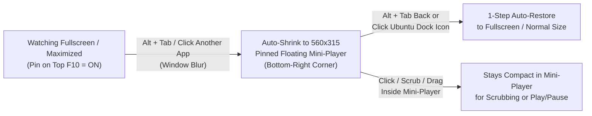

```bash
$ crunchyroll --ozone-platform=x11
```

<h1 align="center">🎬 Crunchyroll Ubuntu Desktop</h1>
<h3 align="center">Mouse, Trackpad, Floating Mini-Player & Smart Auto-PiP Edition for Linux</h3>

<p align="center">
  <a href="https://github.com/pulkitmundra/crunchyroll-ubuntu-desktop">
    
  </a>
</p>

<p align="center">
  
  
  
  
</p>

<p align="center">
  <a href="https://github.com/pulkitmundra/crunchyroll-ubuntu-desktop/stargazers"></a>&nbsp;
  <a href="https://github.com/pulkitmundra"></a>&nbsp;
  <a href="https://pulkit-mundra-portfolio.vercel.app"></a>
</p>

<p align="center">
  <a href="#comparison">Comparison</a> -
  <a href="#architecture">Architecture</a> -
  <a href="#features">Features</a> -
  <a href="#quick-start">Quick Start</a> -
  <a href="#shortcuts">Shortcuts</a> -
  <a href="#author">Author</a>
</p>

> [!NOTE]
> **Disclaimer**: This project is an unofficial, community-maintained desktop client and is **not** affiliated with, endorsed by, or associated with Crunchyroll or Sony Pictures Entertainment. A valid Crunchyroll account is required to stream content.

---

<a id="comparison"></a>
## ⚡ Upstream vs. This Edition

The upstream `crunchyroll-linux` / `crunchyroll-tizen` project was built strictly for TV remote / arrow-key navigation and lacked desktop ergonomics. This edition transforms it into a first-class Ubuntu desktop & multitasking app:

| Capability | Upstream (`crunchyroll-linux`) | This Edition (`crunchyroll-ubuntu-desktop`) |
| :--- | :---: | :---: |
| **Widevine DRM Streaming (1080p)** | `[x]` | `[x]` |
| **Keyboard / Controller Navigation** | `[x]` | `[x]` |
| **Click-to-Play & Double-Click Fullscreen** | `[ ]` | `[x]` |
| **Click & Drag Timeline Scrubbing** | `[ ]` | `[x]` |
| **Synchronized 3s Cursor + HUD Auto-Hide** | `[ ]` | `[x]` |
| **Floating Mini-Player (`560x315`, `F9`)** | `[ ]` | `[x]` |
| **Smart Auto-PiP on `Alt + Tab` (`F10`)** | `[ ]` | `[x]` |
| **Two-Finger Trackpad & Mouse Wheel Scroll** | `[ ]` | `[x]` |
| **Hover-to-Open Left Sidebar Menu** | `[ ]` | `[x]` |
| **Physical Keyboard Live Debounced Search** | `[ ]` | `[x]` |
| **Lowercase `'q'` Search/Login Typing Fix** | `[ ]` | `[x]` |
| **One-Command Live-Editable Installer (`install.sh`)** | `[ ]` | `[x]` |

---

<a id="architecture"></a>
## 🧠 Smart Auto-PiP & Window Architecture

When **Pin on Top (`F10`)** is enabled, the Electron main process (`index.js`) and preload bridge (`preload.js`) coordinate focus, pointer telemetry, and dynamic zoom scaling (`1920x1080` -> `560x315`) so you can seamlessly multitask while watching:



---

<a id="features"></a>
## ✨ Key Desktop Enhancements

<details open>
<summary><b>1. 🎥 Video Player & Timeline Scrubbing (<code>player.js</code>, <code>app.js</code>, <code>video.css</code>)</b></summary><br>

- **Synchronized Auto-Hide HUD & Cursor**: Both the mouse cursor and the top/bottom player HUD bars auto-hide together after **3 seconds** of inactivity during playback and wake immediately on genuine mouse movement (`screenX`/`screenY` delta check filters out synthetic layout `mousemove` events).
- **Click & Drag Timeline Scrubbing**: Click anywhere on the progress bar or drag the scrubber thumb smoothly across the timeline to seek.
- **Full Mouse Controls**:
  - Single-click video surface to toggle **Play / Pause** (`pointer-events` properly layered above `<video>`).
  - Double-click video surface to toggle **Fullscreen** (`electronUtilsRender.toggleFullScreen()`).
  - Click control buttons (`Play/Pause`, `Skip Intro/Credits`, `Next Episode`, `Speed`, `Audio Language`, `Subtitles`).
  - Scroll wheel over the player or settings popup list to scroll audio/subtitle tracks.

</details>

<details open>
<summary><b>2. 🪟 Floating Top Dock, Mini-Player (<code>F9</code>) & Smart Auto-PiP (<code>F10</code>)</b></summary><br>

- **Top-Center Floating Dock (`#top-center-dock`)**: Auto-hiding top-center control bar providing one-click mouse buttons for **Back**, **Menu**, **Mini Float (`F9`)**, and **Pin on Top (`F10`)**.
- **Floating Mini-Player Mode (`F9` or `Ctrl + M`)**: Instantly shrinks the window into a compact `560x315` floating player in the bottom-right corner of your screen (and restores back to normal/fullscreen when toggled again).
- **Pin on Top & Smart Auto-PiP (`F10` or `Ctrl + T`)**:
  - When **Pin on Top** is enabled, switching focus away from Crunchyroll (`Alt + Tab` or clicking another app) automatically shrinks Crunchyroll into a pinned floating mini-player so you can keep watching while coding or browsing.
  - Returning to Crunchyroll via `Alt + Tab` or clicking the Ubuntu Dock icon automatically expands it back to full size in one step, whereas clicking or dragging directly inside the mini-player keeps it compact.
- **Dynamic 1080p Aspect-Ratio Scaling (`updateZoom`)**: Automatically scales the `1920x1080` HTPC UI proportionally (`webContents.setZoomFactor`) to fit any window size down to compact mini-player dimensions.

</details>

<details open>
<summary><b>3. 🖱️ Full Mouse, Trackpad & Hover Navigation (<code>main.js</code>, <code>screen/*.js</code>)</b></summary><br>

- **Hover-to-Open Left Sidebar (`#menu-screen`)**: Moving the cursor to the left edge or hovering over the sidebar expands it automatically and collapses it when the cursor leaves.
- **Right-Click to Go Back**: Right-clicking anywhere acts as **Back / Escape** for effortless one-handed mouse navigation.
- **Smooth Wheel & Two-Finger Trackpad Scrolling**:
  - Vertical scrolling on Home rows, Browse genre lists, Episode lists, Watchlist/History grids, and Search results.
  - Horizontal scrolling (`Shift + Wheel` or horizontal trackpad swipe) across Home carousels.
  - Bidirectional scroll synchronization with virtualized `document.lazy` lists (including upward/downward re-indexing in Browse genres).
- **Hover Previews & Modal Support**:
  - Hovering over Browse genres or Settings categories updates the right-hand preview immediately.
  - Exit confirmation dialog (`exit.js`) supports direct mouse clicks on **YES** / **NO**, blocks click-through behind the modal, and closes on `Escape` or backdrop click.

</details>

<details open>
<summary><b>4. ⌨️ Keyboard, Live Search & Ubuntu Wayland/X11 Fixes</b></summary><br>

- **Lowercase `'q'` Typing Fix (`keyboard.js`, `keys.js`)**: Pressing lowercase `q` in the search box or login fields types `'q'` normally instead of triggering app exit (`KeyQ` exit shortcut is safely restricted to `Ctrl + Q`).
- **Live Debounced Search (`search.js`)**: Typing with a physical keyboard triggers live search automatically after `400ms` without needing to click the on-screen keyboard's Enter key.
- **Movie Detail & Playback Support (`home.details.js`)**: Fixed movie (`movie_listing`) play/continue actions when opening movies from the Home screen or Search.
- **X11 / XWayland Windowing (`bin/crunchyroll`, `index.js`)**: Configured with `--ozone-platform=x11` so Chromium's cursor visibility, mini-player bounds, and fullscreen window management work reliably under Ubuntu GNOME Wayland.

</details>

---

<a id="quick-start"></a>
## 🚀 Quick Start (Ubuntu / Debian / Linux x64)

Because Crunchyroll streams are encrypted with **Google Widevine DRM**, standard stock Electron binaries cannot play videos. This app runs inside the **Castlabs Electron for Content Security (ECS)** runtime (which includes Widevine CDM verification).

### One-Command Setup

```bash
git clone https://github.com/pulkitmundra/crunchyroll-ubuntu-desktop.git ~/Desktop/prsnl/crunchyroll-ubuntu-desktop
cd ~/Desktop/prsnl/crunchyroll-ubuntu-desktop
chmod +x install.sh
./install.sh
```

<details>
<summary><b>🔍 What <code>./install.sh</code> does under the hood (Click to expand)</b></summary><br>

1. Downloads the v1.1.6 AppImage containing the **Castlabs Electron + Widevine** runtime to `~/.local/opt/crunchyroll/Crunchyroll.AppImage` (if not already present).
2. Extracts the runtime into `~/.local/opt/crunchyroll/unpacked/`.
3. Removes the stock `resources/app.asar` bundle and symlinks `~/.local/opt/crunchyroll/unpacked/resources/app` -> this repository.
   - **Live Editing**: Any change you make to `.js`, `.css`, or `.html` files in this repository takes effect immediately the next time you launch or reload (`Ctrl + R` / `F5`) the app!
4. Symlinks `~/.local/bin/crunchyroll` -> `bin/crunchyroll` and installs the desktop launcher at `~/.local/share/applications/crunchyroll-linux.desktop`.

</details>

### Launching the App

- **GNOME Application Grid**: Search for **Crunchyroll**
- **Terminal**:
  ```bash
  crunchyroll
  ```

---

<a id="shortcuts"></a>
## 🎮 Keyboard & Mouse Shortcuts

| Action | Mouse / Trackpad | Keyboard |
| :--- | :--- | :--- |
| **Play / Pause** | Single-click video or Play button | `Space` or `Enter` |
| **Toggle Fullscreen** | Double-click video | `F11` |
| **Toggle Mini Float Window** | Click **Mini Float** in top dock | `F9` or `Ctrl + M` |
| **Toggle Pin on Top / Auto-PiP** | Click **Pin on Top** in top dock | `F10` or `Ctrl + T` |
| **Seek Forward / Backward** | Click or drag timeline progress bar | `Left` / `Right` Arrow |
| **Skip Intro / Credits** | Click **Skip** button | `Enter` (when Skip button is shown) |
| **Open Sidebar Menu** | Hover left edge / click **Menu** in top dock | `Left` Arrow from screen edge |
| **Back / Close Modal** | Right-click anywhere / click **Back** in top dock | `Escape` or `Backspace` |
| **Reload App (Ignore Cache)** | - | `F5` or `Ctrl + R` |
| **Quit Application** | Confirm Exit Dialog | `Ctrl + Q` |

---

<details>
<summary><b>📂 Repository Structure (Click to expand)</b></summary><br>

```text
crunchyroll-ubuntu-desktop/
├── index.js                      # Electron main process (window, mini-player, auto-PiP, fullscreen IPC)
├── preload.js                    # Electron preload bridge (pointer/hover telemetry & window IPC)
├── index.html                    # Outer Electron shell
├── package.json                  # Package metadata
├── install.sh                    # Automated installer (downloads Castlabs Widevine runtime & links repo)
├── LICENSE                       # ISC License
├── bin/
│   ├── crunchyroll               # CLI launcher script (~/.local/bin/crunchyroll)
│   └── crunchyroll-linux.desktop # Desktop entry template (~/.local/share/applications/)
├── css/
│   └── app.css                   # Outer shell, top floating dock & cursor/HUD visibility rules
├── js/
│   ├── app.js                    # Renderer bootstrap, floating toolbar, mouse/wheel/hover/scrub handlers
│   └── keys.js                   # Keycode mappings
└── server/
    ├── css/                      # Screen stylesheets (video.css, home.css, browse.css, etc.)
    └── js/
        ├── main.js               # Controller router & global mouse/wheel/hover wiring
        ├── core/                 # Player, Dash/Widevine DRM, Crunchyroll API service, session
        └── screen/               # Screen controllers (home, browse, search, episodes, settings, exit)
```

</details>

---

<a id="author"></a>
## 👨🏻‍💻 Author & Contact

Built and maintained by **Pulkit Mundra** (Senior Software Developer - SDE-3). Issues, feature requests, and pull requests are welcome!

<p align="left">
  <a href="https://pulkit-mundra-portfolio.vercel.app">
    
  </a>
  <a href="https://github.com/pulkitmundra">
    
  </a>
  <a href="https://www.linkedin.com/in/pulkit-mundra/">
    
  </a>
  <a href="mailto:pmundra8@gmail.com">
    
  </a>
</p>

## 📜 Credits & License

- Original Tizen frontend by [jhassan8/crunchyroll-tizen](https://github.com/jhassan8/crunchyroll-tizen)
- Electron Linux wrapper by [aarron-lee/crunchyroll-linux](https://github.com/aarron-lee/crunchyroll-linux)
- Desktop Mouse/Trackpad, Floating Dock & Smart Auto-PiP Edition by [Pulkit Mundra](https://github.com/pulkitmundra)
- License: **ISC** (see [`LICENSE`](LICENSE))

---

<p align="center">
  <b>If you enjoy watching Crunchyroll on Ubuntu with this desktop client, please consider giving the repo a ⭐!</b>
</p>
